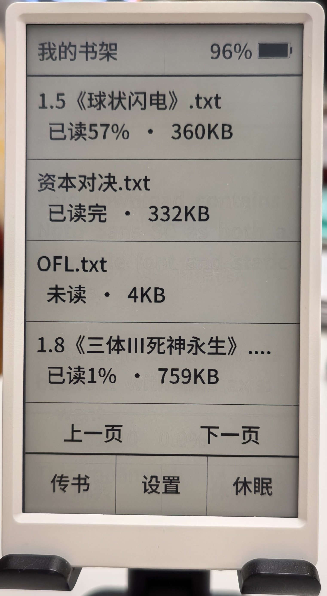
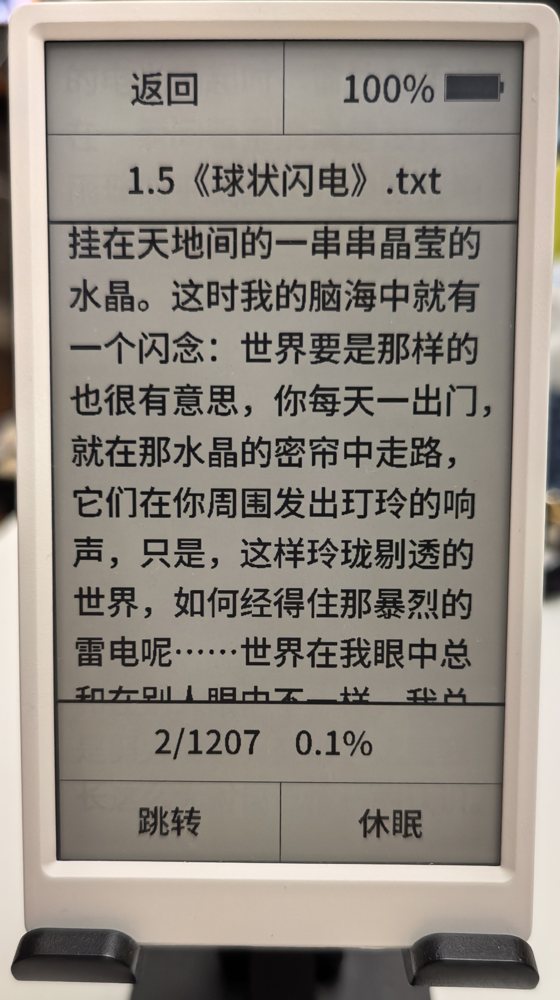
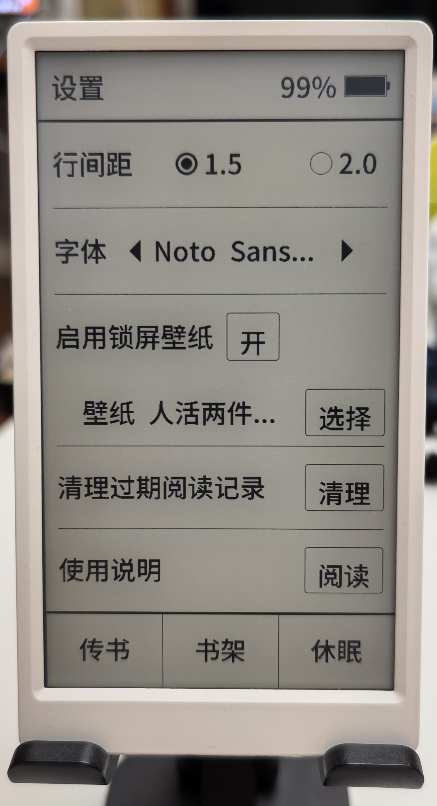
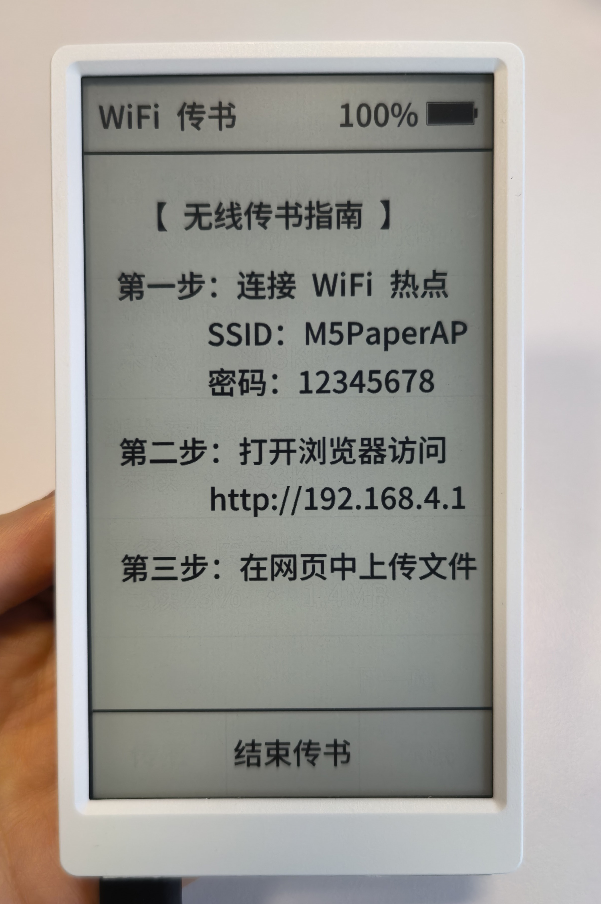
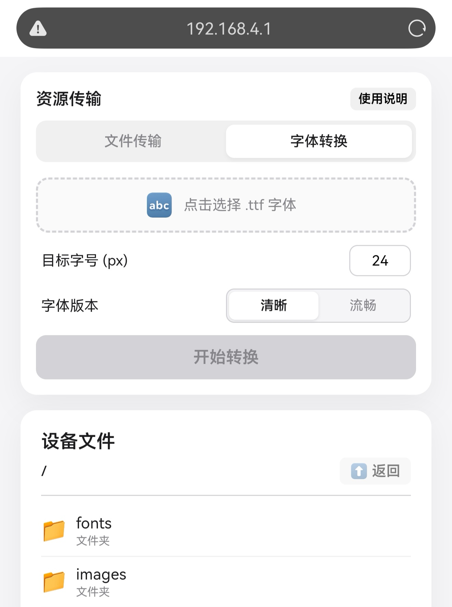
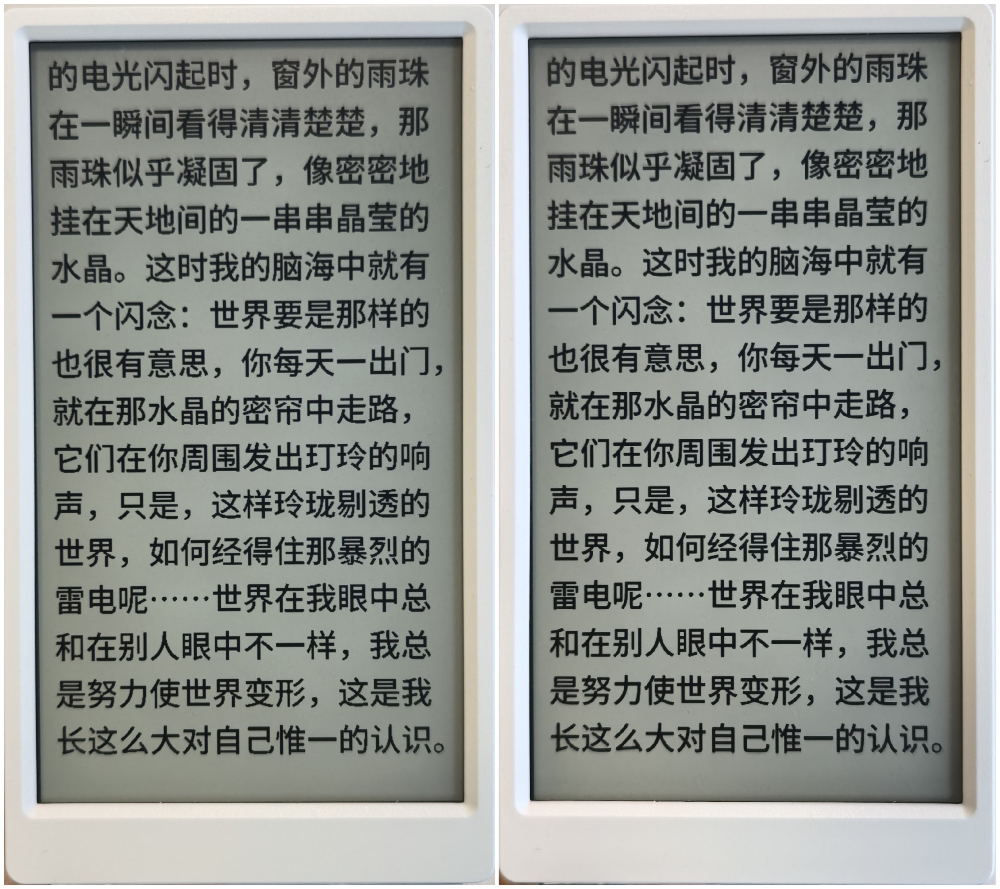

# M5Paper E-Ink Ebook Reader | M5Paper 电子书阅读器

[简体中文](#简体中文) | [English](#english)

---

<a name="简体中文"></a>
## 简体中文版本

一款适用于 **M5Paper v1 及 v1.1** (ESP32 + 电子纸墨水屏) 开发套件的中文 TXT / EPUB 电子书阅读器。

本项目在墨水屏上实现了中文阅读功能，包含自定义字体渲染、后台分页索引、章节目录跳转、书架排序、休眠壁纸选择，以及用于在局域网内传输书籍、字体和图片的 Web
界面。

> [!NOTE]
> 本项目仅用于个人学习与探索。在开发过程中，使用了 AI 辅助进行设计、编写及调试，并参考了优秀的开源项目
> [M5ReadPaper](https://github.com/shinemoon/M5ReadPaper)。

### 功能特性

*   **TXT 与 EPUB 双格式**：
    *   TXT 支持 **UTF-8**、**GBK / GB18030** 与 **UTF-16 (LE/BE)** 编码自动识别与转换，
        并在后台自动识别章节标题生成目录。
    *   EPUB 支持 EPUB 2 / 3：书架显示书名，读取书内目录，封面与插图以独立插图页显示（支持渐进式 JPEG）。首次打开先显示开头章节，
        其余章节在后台逐步转换。
    *   针对中文排版与行首禁则标点的换行处理。
*   **章节目录与精准跳转**：
    *   阅读菜单中打开「目录」即可跳转到任意章节。
    *   支持按页码或百分比数字键盘跳转，顶部实时显示当前页码、总页数与进度。
    *   打开书籍即刻渲染首屏，后台增量建立分页索引（`.idx`）。
*   **书架**：
    *   支持 **最近阅读**、**书名**（拼音序）、**阅读进度**、**最近导入** 四种排序，排序方式自动保存。
    *   单页显示 6 本书，每本书标注格式、文件大小与阅读进度，未打开过的书显示「未读」。
    *   上下 / 左右滑动或拨动滚轮翻页；长按书籍可清除阅读记录或删除书籍。
*   **自定义字体系统（直读 `.ttf` / `.otf` + `.bin` 字体包）**：
    *   支持直接将 `.ttf` / `.otf` 字体放入 `/fonts` 目录由 FreeType 实时渲染，并在后台自动将常用字形缓存到 SD
        卡 `/configs/fontcache/`，兼顾任意字号缩放与翻页速度。
    *   同时支持网页端或脚本预转换生成的自定义二进制字体（`.bin`）。
    *   **界面字体与正文字体分离**：界面字体固定 30px（内置或 `.ttf`），正文字体独立选择。
    *   **内置备用字体**：若外部 SD 卡字体文件缺失，系统自动退回内置 30px 字体。
*   **阅读排版与方向设置（带实时预览）**：
    *   **正文字号**：`.ttf` 字体支持 **20px–60px**（步进 2，支持步进器与数字键盘直接输入）。
    *   **行间距**：**1.0–3.0** 倍，步距 0.1，支持数字键盘输入小数。
    *   **页边距**：支持 **0–80px** 预设档位切换与数字键盘自定义输入。
    *   **段首缩进与行下虚线**：支持一键开启统一两字符段首缩进与行下辅助虚线。
    *   **四向阅读（`↓` / `←` / `↑` / `→`）**：支持竖屏、左右横屏及竖屏倒置四个方向，触控与滚轮方向自动跟随。
    *   **全刷间隔**：支持 **1–99 页** 自定义全局刷新间隔。
*   **阅读操作设置**：
    *   **点击区域**：三栏或九宫格，每个区域可设为上一页、下一页、菜单、全刷或无。
    *   **滑动操作**：分别设置向左、右、上、下滑动时的功能。
    *   **自动翻页**：按设定秒数自动翻到下一页。
    *   **滚轮方向**：可交换滚轮的上一页 / 下一页方向。
*   **Wi-Fi 无线传书 (Web UI)**：
    *   在书架页开启局域网热点，使用手机或电脑浏览器批量上传 `.txt` / `.epub` 电子书、`.ttf` / `.otf` / `.bin`
        字体文件及锁屏图片；遇到同名文件会先询问是否覆盖。
*   **电源与存储管理**：
    *   **深度休眠**（默认，最省电）或 **浅休眠**（拨动滚轮即可唤醒），唤醒后回到休眠前的页面或阅读位置。
    *   选择 SD 卡中的图片作为锁屏壁纸，支持半透明 PNG 叠加在休眠前的画面上。
    *   系统设置中可查看并一键清理已删除书籍遗留的阅读记录与缓存，以及未使用的 TTF 字形缓存。

### 实物效果与截图

| 书架界面展示 | 阅读界面展示 | 设置页面展示 |
| :---: | :---: | :---: |
|  <br> *设备主页书架* |  <br> *设备阅读文本渲染* |  <br> *设备阅读参数调整* |

| 设备端传输界面 | 客户端传书网页 | 不同字体效果对比 |
| :---: | :---: | :---: |
|  <br> *设备开热点传书界面* |  <br> *浏览器端上传页面* |  <br> *流畅版 vs. 清晰版渲染对比* |

### 基本操作

阅读器支持通过屏幕触控和设备顶部的物理滚轮按键进行操作。

#### 阅读页操作

*   **翻页（触控）**：默认点击屏幕左侧 1/3 区域为上一页，右侧 1/3 区域为下一页；向左滑为下一页，向右滑为上一页。
*   **翻页（滚轮）**：上下拨动物理滚轮进行翻页。
*   **清除残影**：向内短按物理滚轮键进行全局刷新。
*   **唤出菜单**：默认点击屏幕中央 1/3 区域或向下滑动。
*   以上点击与滑动功能都可以在「操作设置」中修改。

#### 阅读菜单

*   **“返回”**：点击左上角返回书架。
*   **进度与跳转**：点击底部阅读进度栏，弹出数字键盘，支持按页码或按百分比跳转。
*   **“目录”**：打开章节目录，点击章节即可跳转。
*   **“阅读设置”**：直接进入阅读设置页（带实时正文预览），修改后返回立即生效。
*   **“休眠”**：使设备立即进入休眠。
*   **关闭菜单**：点击屏幕上方空白区域即可关闭菜单。

#### 休眠与唤醒

*   在书架、系统设置或阅读菜单底部点击 **休眠** 按钮即可进入休眠，休眠方式在「系统设置 > 休眠模式」中选择：
    *   **深度休眠**（默认）：设备完全断电，最省电。向内长按物理滚轮键 **3 秒** 开机。
    *   **浅休眠**：设备保持供电，按下或上下拨动滚轮即可立即唤醒，但待机耗电更多；连续浅休眠超过 24 小时会自动转为深度休眠。

#### 书架页与系统设置

*   **书架**：显示 SD 卡 `/books` 目录下的书籍。点击书籍即可开始阅读；点击顶栏中间的排序名称可切换排序方式；
    长按书籍可清除阅读记录或删除书籍。
*   **传书**：点击底部状态栏的 **传书** 按钮启动局域网热点，通过电脑或手机连接并访问屏幕提示的 IP 地址上传电子书、字体与图片。
*   **系统设置**：点击书架底部状态栏的 **设置** 按钮进入系统设置：
    *   *阅读设置*：分为「排版设置」（正文字体、字号、行间距、页边距、段首缩进、行下虚线、阅读方向）与「操作设置」（全刷间隔、自动翻页、点击区域、
        滑动操作、滚轮方向）两页。
    *   *界面字体*：切换系统 UI 字体（内置字体或 `/fonts` 下的 `.ttf` 字体）。
    *   *休眠模式*：深度休眠或浅休眠。
    *   *锁屏壁纸*：开关自定义锁屏壁纸并从 `/images` 选择图片。
    *   *过期阅读记录*：显示并一键清理已删除书籍遗留的阅读记录与缓存（`.cfg` / `.idx` / `.epc` / `.toc`）。
    *   *字体缓存*：显示 `/configs/fontcache/` 占用空间，一键清理当前未使用的 TTF 字形缓存。
    *   *使用说明*：设备内置的操作说明，右侧显示当前固件版本号。

### 快速上手

#### 方式一：从源码编译与烧录（推荐）

1.  安装 **PlatformIO Core (命令行工具)**。您可以通过 pip 快速安装：
    ```bash
    pip install -U platformio
    ```
    *(其他安装方法请参考 [PlatformIO CLI
    官方安装指南](https://docs.platformio.org/en/latest/core/installation/index.html))*
2.  克隆本项目，并进入项目根目录：
    ```bash
    git clone https://github.com/zsyai/m5paper-ebook.git
    cd m5paper-ebook
    ```
3.  使用 USB-C 数据线将 M5Paper 连接至电脑。
4.  编译并烧录固件：
    ```bash
    pio run -t upload
    ```
5.  *(可选)* 开启串口监视器查看运行日志：
    ```bash
    pio device monitor
    ```

#### 方式二：烧录发布固件

如果不想编译源码，也可以从 [Releases](https://github.com/zsyai/m5paper-ebook/releases)
页面下载单文件固件（例如 `m5paper-reader-v1.2.0.bin`），用 PlatformIO 自带的烧录工具写入设备，
无需另外安装其他工具（需先按方式一第 1 步安装 PlatformIO）：
```bash
pio pkg exec -p tool-esptoolpy -- esptool.py --chip esp32 write_flash 0x0 m5paper-reader-v1.2.0.bin
```
烧录完成后设备自动重启。SD 卡上的书籍、阅读进度与设置都会保留。

### 使用说明与文件管理

#### SD 卡目录结构
请准备一张格式化为 FAT32 的 Micro SD 卡插入 M5Paper。

*   **自动创建**：系统会在首次开机时自动创建 `/configs` 目录。此外，当您**进入“WiFi 传书”页面**或上传文件时，系统会**自动创建
    `/books`、`/fonts` 和 `/images` 目录**。
*   **手动拷贝**：如果您是通过电脑读卡器线下拷贝文件，则需要手动构建以下目录结构：

```text
SD Card/
├── books/                  # 存放 .txt / .epub 电子书（若通过读卡器拷贝，需手动创建该目录）
├── configs/                # 系统自动生成的设置、阅读记录、分页索引与字体缓存
├── fonts/                  # 存放 .ttf / .otf 字体或转换后的 .bin 字体
└── images/                 # 存放锁屏 / 休眠壁纸图片（540x960 的 .png / .jpg）
```

#### Wi-Fi 无线传书

1.  在书架页面，点击底部状态栏的 **“传书”** 按钮。
2.  M5Paper 将自动建立一个局域网 Wi-Fi 热点。请将您的手机或电脑连接至屏幕上显示的 Wi-Fi 名称与密码。
3.  连接成功后，在手机/电脑的浏览器中输入屏幕上显示的 IP 地址（如 `http://192.168.4.1`）。
4.  在传书网页中选择书籍、字体或图片（可一次选择多个文件）直接上传。

#### 自定义字体生成与转换
`.ttf` / `.otf` 字体可以直接放入 `/fonts` 使用。如果需要预先转换成 `.bin` 字体，可以在传书网页中转换上传，或使用项目自带的
Python 脚本：
```bash
python tools/ttf2bin.py input_font.ttf output_font.bin
```
转换完成后，您可以**直接将生成的 `.bin` 字体文件拷贝至 SD 卡的 `/fonts` 目录下**，或者通过上述 **Wi-Fi 无线传书**
网页上传至设备，然后在设置页面中切换使用即可。

---

<a name="english"></a>
## English Version

A Chinese TXT / EPUB ebook reader designed for the **M5Paper v1 and v1.1**
(ESP32 + E-Ink) development kit.

This project provides a Chinese reading implementation on the e-paper screen,
featuring custom font rendering, background pagination indexing, chapter
navigation, bookshelf sorting, custom wallpaper selection, and a web-based
interface for transferring books, fonts, and images over Wi-Fi.

> [!NOTE]
> This project is solely for personal learning and exploration. During the
> development process, AI was used to assist with design, coding, and debugging,
> with reference to the excellent
> [M5ReadPaper](https://github.com/shinemoon/M5ReadPaper) project.

### Features

*   **TXT and EPUB**:
    *   TXT: automatic detection and conversion for **UTF-8**, **GBK /
        GB18030**, and **UTF-16 (LE/BE)**, with chapter headings detected in the
        background to build a table of contents.
    *   EPUB 2 / 3: book titles on the bookshelf, the book's own table of
        contents, and cover and illustrations shown on dedicated image pages
        (progressive JPEG supported). A new EPUB opens on its first chapters
        right away while the rest is converted in the background.
    *   Word wrapping and line-start punctuation rules (kinsoku) for Chinese
        typography.
*   **Chapter Navigation & Jump**:
    *   Open **TOC** from the reading menu to jump to any chapter.
    *   Jump by page number or percentage via a numeric keypad displaying
        current page, total pages, and progress.
    *   Opens books immediately and builds binary `.idx` page indexes
        incrementally in the background.
*   **Bookshelf**:
    *   Four sort modes, saved across restarts: **Recently Read**, **Title**
        (Pinyin order), **Reading Progress**, and **Recently Imported**.
    *   Six books per page, each showing format, file size, and reading
        progress; books never opened are marked as unread.
    *   Swipe in any direction or scroll the wheel to change pages; long-press a
        book to clear its reading record or delete it.
*   **Custom Font Subsystem (Direct `.ttf` / `.otf` + `.bin` Packs)**:
    *   Directly renders `.ttf` / `.otf` fonts from `/fonts` via FreeType and
        automatically builds glyph caches in `/configs/fontcache/` in the
        background.
    *   Also supports pre-converted `.bin` font packs generated via the Web UI
        or Python script.
    *   **Separate UI & Body Fonts**: Fixed 30px UI font (built-in or `.ttf`)
        independent from the scalable body font.
    *   **Built-in Fallback**: Automatically falls back to the embedded 30px
        font if the external font file is missing.
*   **Reading Layout & Orientation Settings (with Live Preview)**:
    *   **Body Font Size**: Adjustable from **20px to 60px** (step 2, stepper
        buttons or numeric keypad input) for `.ttf` fonts.
    *   **Line Spacing**: **1.0x to 3.0x** in steps of 0.1, with decimal keypad
        input.
    *   **Page Margins**: Adjustable from **0px to 80px** via presets or numeric
        keypad input.
    *   **Paragraph Indent & Line Guides**: Optional uniform 2-character
        paragraph indentation and dashed under-line reading guides.
    *   **4-Direction Reading (`↓` / `←` / `↑` / `→`)**: Portrait, left/right
        landscape, and inverted portrait orientations with automatic touch and
        wheel mapping.
    *   **Full-Refresh Interval**: Configurable from **1 to 99 pages**.
*   **Reading Controls**:
    *   **Tap Zones**: three columns or a 3 x 3 grid; each zone can be set to
        previous page, next page, menu, full refresh, or nothing.
    *   **Swipes**: choose the action for left, right, up, and down swipes.
    *   **Auto Page Turn**: turns to the next page every N seconds.
    *   **Wheel Direction**: swap the wheel's previous / next page directions.
*   **Wi-Fi File Transfer (Web UI)**:
    *   Runs a local Web Server on M5Paper to batch-upload `.txt` / `.epub`
        books, `.ttf` / `.otf` / `.bin` fonts, and lock-screen images from your
        phone or computer; asks before overwriting a file with the same name.
*   **Power & Storage Management**:
    *   **Deep sleep** (default, lowest power) or **light sleep** (wake by
        rolling the wheel); the device returns to the page or reading position
        it slept on.
    *   Lock-screen wallpaper from images on the SD card; semi-transparent PNGs
        are drawn over the last screen.
    *   System Settings shows and cleans up leftover reading records and caches
        of deleted books, and unused TTF font caches.

### Demos & Physical Screenshots

| Bookshelf Interface | Reading Interface | Settings Page |
| :---: | :---: | :---: |
|  <br> *Device bookshelf screen* |  <br> *Device reading rendering* |  <br> *Device settings adjustments* |

| Device Transfer Hotspot | Web Upload Client | Font Contrast Comparison |
| :---: | :---: | :---: |
|  <br> *Device hotspot info page* |  <br> *Web client upload page* |  <br> *Fluency vs. Clarity comparison* |

### Operations

The reader is operated via the touchscreen and the physical wheel button.

#### Reading Page

*   **Page Turn (Touch)**: By default, tap the left 1/3 of the screen for the
    previous page and the right 1/3 for the next page; swipe left for the next
    page and right for the previous page.
*   **Page Turn (Wheel)**: Scroll the physical wheel button up/down to flip
    pages.
*   **Clear Screen Ghosting**: Briefly press the physical wheel button inward.
*   **Open Reading Menu**: By default, tap the center 1/3 of the screen or swipe
    down.
*   All tap and swipe actions can be changed in **Controls Settings**.

#### Reading Menu

*   **Return**: Tap the top-left button to return to the Bookshelf.
*   **Progress & Jump**: Tap the progress row in the bottom bar to open the
    numeric keypad and jump by page number or percentage.
*   **TOC**: Open the table of contents and tap a chapter to jump to it.
*   **Reading Settings**: Open Reading Settings (with live preview); changes
    apply when you return.
*   **Sleep**: Put the device to sleep immediately.
*   **Close Menu**: Tap the blank area at the top of the screen.

#### Sleep & Wake

*   Tap **Sleep** in the bottom bar of the Bookshelf, System Settings, or the
    reading menu. Choose the mode in **System Settings > Sleep Mode**:
    *   **Deep sleep** (default): the device powers off completely and uses the
        least battery. Press and hold the wheel button inward for **3 seconds**
        to power on.
    *   **Light sleep**: the device stays powered and wakes as soon as you press
        or roll the wheel, but uses more standby power. After 24 hours of light
        sleep it switches to deep sleep.

#### Bookshelf & System Settings

*   **Bookshelf**: Shows the books in `/books` on the SD card. Tap a book to
    read it, tap the sort name in the middle of the top bar to change the sort
    order, and long-press a book to clear its reading record or delete it.
*   **Wi-Fi Transfer**: Tap **Transfer** in the bottom navigation bar to start a
    local hotspot, then connect via phone/computer and visit the displayed IP
    address to upload books, fonts, and images.
*   **System Settings**: Tap **Settings** in the bookshelf bottom bar:
    *   *Reading Settings*: Two pages: **Layout** (body font, font size, line
        spacing, margins, paragraph indent, line guides, reading direction) and
        **Controls** (full-refresh interval, auto page turn, tap zones, swipes,
        wheel direction).
    *   *UI Font*: Switch the 30px UI font between the built-in font and `.ttf`
        fonts in `/fonts`.
    *   *Sleep Mode*: Deep sleep or light sleep.
    *   *Lock Screen Wallpaper*: Enable/disable and pick a lock screen image
        from `/images`.
    *   *Expired Reading Records*: Shows the size of, and removes, leftover
        records and caches (`.cfg` / `.idx` / `.epc` / `.toc`) of deleted books.
    *   *Font Cache*: Shows the size of `/configs/fontcache/` and cleans up
        unused TTF glyph caches.
    *   *User Guide*: Built-in instructions; the current firmware version is
        shown next to it.

### Getting Started

#### Option 1: Build and Flash from Source (Recommended)

1.  Install **PlatformIO Core (CLI)**. You can install it via pip:
    ```bash
    pip install -U platformio
    ```
    *(For alternative installation methods, refer to [PlatformIO CLI
    Installation
    Guide](https://docs.platformio.org/en/latest/core/installation/index.html))*
2.  Clone this repository and navigate to the project root:
    ```bash
    git clone https://github.com/zsyai/m5paper-ebook.git
    cd m5paper-ebook
    ```
3.  Connect your M5Paper to your computer via a USB-C cable.
4.  Build and upload the firmware:
    ```bash
    pio run -t upload
    ```
5.  *(Optional)* Open the serial monitor to view logs:
    ```bash
    pio device monitor
    ```

#### Option 2: Flash the Release Firmware

If you prefer not to build from source, download the single-file firmware (such
as `m5paper-reader-v1.2.0.bin`) from the
[Releases](https://github.com/zsyai/m5paper-ebook/releases) page and write it
with the flashing tool bundled in PlatformIO. No other tool is needed (install
PlatformIO first, as in step 1 of Option 1):
```bash
pio pkg exec -p tool-esptoolpy -- esptool.py --chip esp32 write_flash 0x0 m5paper-reader-v1.2.0.bin
```
The device restarts when flashing finishes. Books, reading progress, and
settings on the SD card are kept.

### Usage & File Management

#### SD Card Directory Structure
Insert a FAT32-formatted Micro SD card into the M5Paper.

*   **Auto-generated**: The system automatically creates `/configs` on the first
    boot, and **automatically creates `/books`, `/fonts`, and `/images`** when
    you enter the "WiFi Transfer" page or upload files.
*   **Manual Copying**: If you are copying files offline via an SD card reader,
    you should manually prepare the following structure:

```text
SD Card/
├── books/                  # .txt / .epub ebooks (create manually if copying via PC card reader)
├── configs/                # Auto-generated settings, reading records, page indexes, and font caches
├── fonts/                  # .ttf / .otf fonts or converted .bin fonts
└── images/                 # Lock screen wallpapers (540x960 .png / .jpg)
```

#### Wi-Fi Book & Font Transfer

1.  From the Bookshelf page, tap **"Transfer"** in the bottom navigation bar.
2.  The M5Paper will start a local Wi-Fi hotspot. Connect your phone or computer
    to the Wi-Fi network and password displayed on the screen.
3.  Open your web browser and navigate to the URL shown on the M5Paper display
    (e.g., `http://192.168.4.1`).
4.  Choose books, fonts, or images (several files at once are fine) in the web
    interface and upload them.

#### Converting Custom Fonts
`.ttf` / `.otf` fonts can be used directly from `/fonts`. To pre-convert a font
into the `.bin` format, use the converter in the transfer web page or the
bundled Python script:
```bash
python tools/ttf2bin.py input_font.ttf output_font.bin
```
Once converted, you can **directly copy the `.bin` font file to the `/fonts`
directory on your SD card**, or upload it via the Wi-Fi Transfer web interface,
then select it in the Settings page.
