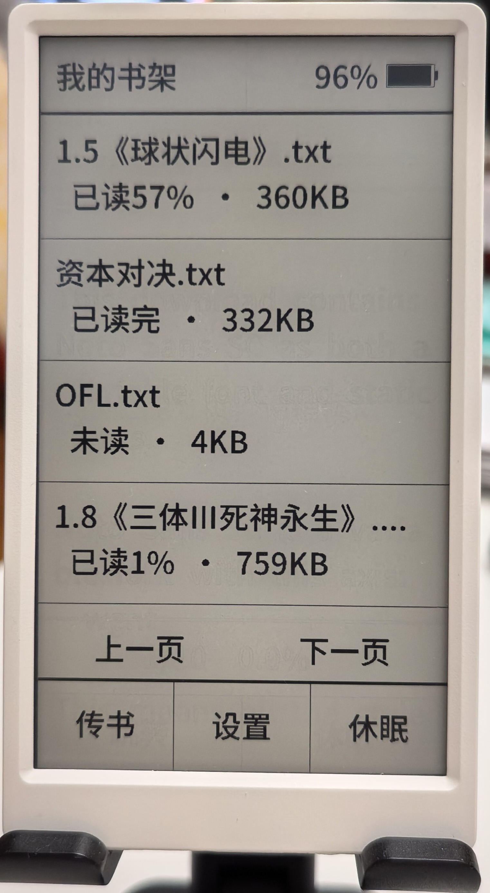
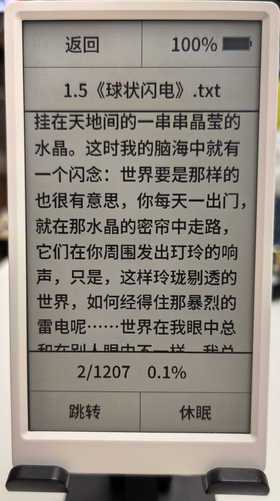
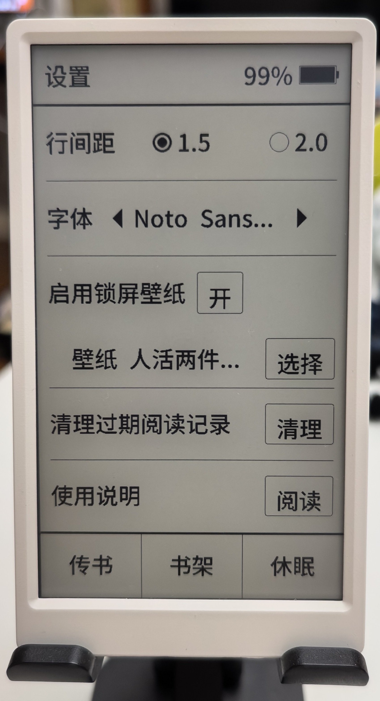
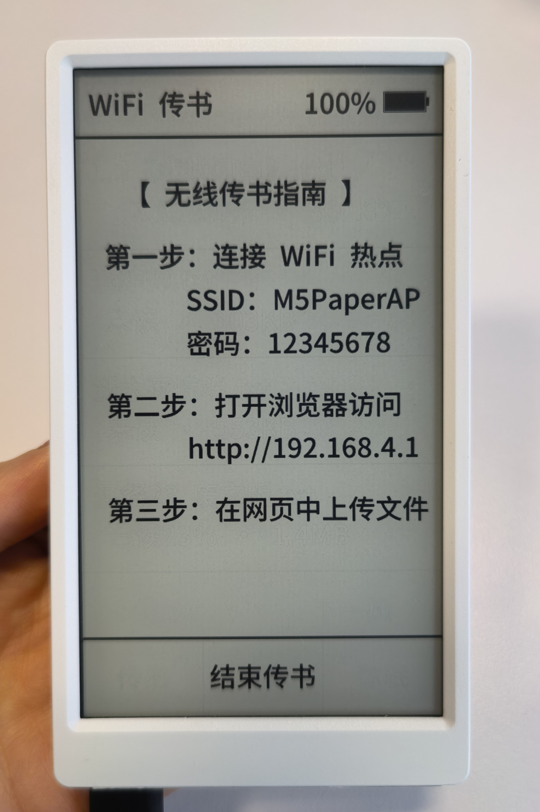
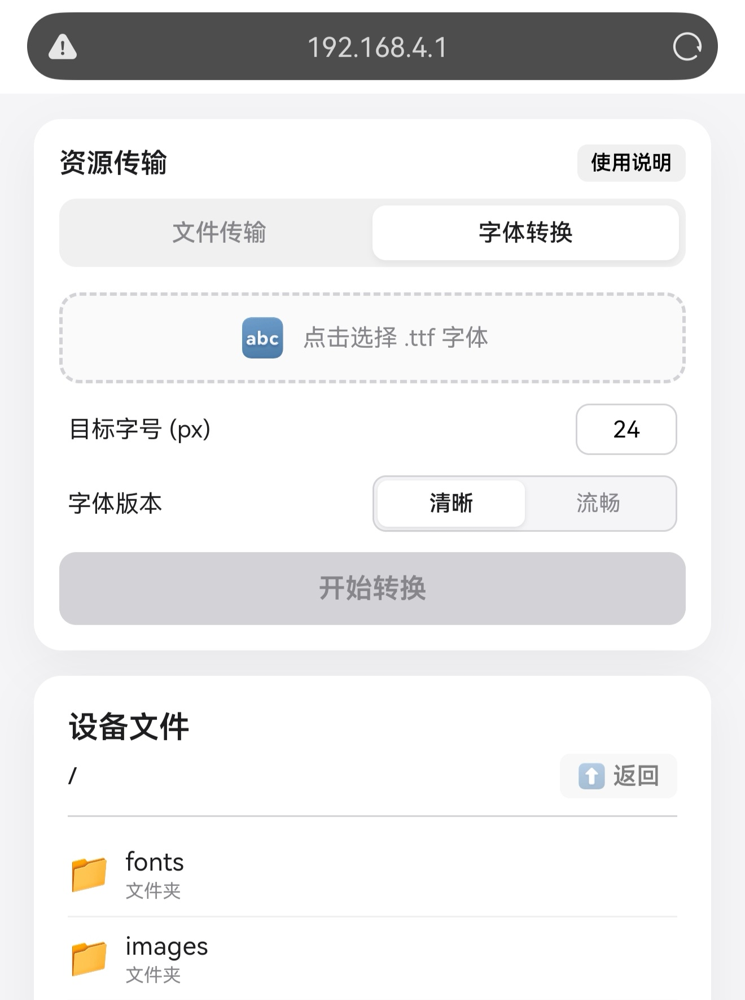
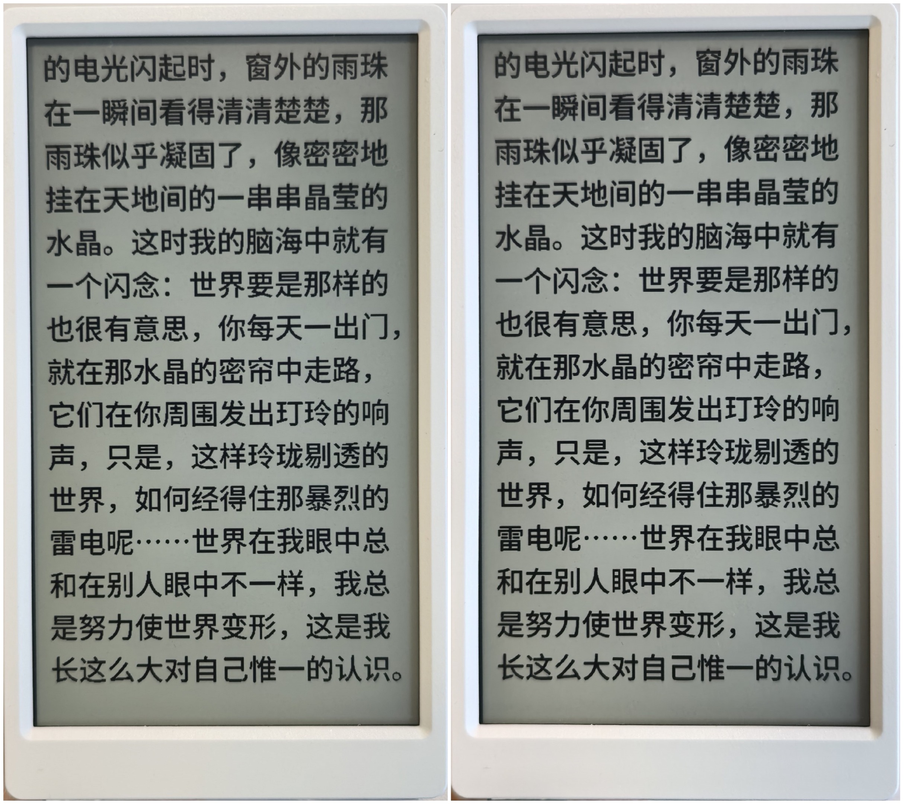

# M5Paper E-Ink Ebook Reader | M5Paper 电子书阅读器

[简体中文](#简体中文) | [English](#english)

---

<a name="简体中文"></a>
# 简体中文版本

一款适用于 **M5Paper v1 及 v1.1** (ESP32 + 电子纸墨水屏) 开发套件的基础中文 TXT 电子书阅读器。

本项目在墨水屏上实现了中文阅读功能，包含自定义字体渲染、后台分页索引、休眠壁纸选择，以及用于在局域网内传输书籍和字体的 Web 界面。

> [!NOTE]
> 本项目仅用于个人学习与探索。在开发过程中，使用了 AI 辅助进行设计、编写及调试，并参考了优秀的开源项目 [M5ReadPaper](https://github.com/shinemoon/M5ReadPaper)。

## 功能特性

*   **高对比度墨水屏界面**：包含电池图标、触控区域与局部刷新支持。
*   **多编码中文文本支持**：
    *   支持 **UTF-8**、**GBK / GB18030** 与 **UTF-16 (LE/BE)** 编码格式自动识别与转换。
    *   实现针对中文排版与行首禁则标点的换行处理。
*   **自定义字体系统（直读 `.ttf` + `.bin` 字体包）**：
    *   支持直接将 `.ttf` 字体放入 `/fonts` 目录由 FreeType 实时渲染，并在后台自动将常用字形缓存为 SD 卡 `/configs/fontcache/` 下的 `.bin` 缓存文件，兼顾任意字号缩放与翻页速度。
    *   同时支持网页端或脚本预转换生成的自定义二进制字体（`.bin`）。
    *   **界面字体与正文字体分离**：界面字体固定 30px（内置或 `.ttf`），正文字体独立选择。
    *   **内置 NotoSansSC 备用**：若外部 SD 卡字体文件缺失，系统自动退回内置 30px 字体。
*   **丰富的阅读排版与方向设置（带实时预览）**：
    *   **正文字号**：`.ttf` 字体支持 **20px–60px**（步进 2，支持步进器与数字键盘直接输入）。
    *   **行间距**：支持 **1.0 / 1.5 / 2.0 / 2.5 / 3.0** 五档调节。
    *   **页边距**：支持 **0–80px** 预设档位切换与数字键盘自定义输入。
    *   **段首缩进与行下虚线**：支持一键开启统一两字符段首缩进与行下辅助虚线。
    *   **四向阅读（`↓` / `←` / `↑` / `→`）**：支持竖屏、左右横屏及竖屏倒置四个方向，触控与滚轮方向自动跟随。
    *   **全刷间隔**：支持 **1–99 页** 自定义全局刷新间隔。
*   **后台增量分页与精准跳转**：
    *   打开书籍即刻渲染首屏，后台增量建立二进制分页索引（`.idx`）。
    *   支持按页码或按百分比数字键盘精准跳转，顶部实时显示当前页码、总页数与进度。
*   **Wi-Fi 无线传书与传字体 (Web UI)**：
    *   在书架页开启局域网热点，使用手机或电脑浏览器上传 `.txt` 电子书、`.ttf` 或 `.bin` 字体文件及锁屏图片。
*   **电源与存储管理**：
    *   选择 SD 卡中的图片作为待机锁屏壁纸。
    *   深度睡眠支持（支持开机直达阅读界面，长按滚轮键唤醒）。
    *   一键清理已删除书籍的过期阅读记录，以及清理未使用的 TTF 字形缓存文件。

## 实物效果与截图

| 书架界面展示 | 阅读界面展示 | 设置页面展示 |
| :---: | :---: | :---: |
|  <br> *设备主页书架* |  <br> *设备阅读文本渲染* |  <br> *设备阅读参数调整* |

| 设备端传输界面 | 客户端传书网页 | 不同字体效果对比 |
| :---: | :---: | :---: |
|  <br> *设备开热点传书界面* |  <br> *浏览器端上传页面* |  <br> *流畅版 vs. 清晰版渲染对比* |

## 基本操作

阅读器支持通过屏幕触控和设备顶部的物理滚轮按键进行操作。

### 阅读页操作
*   **翻页（触控）**：点击屏幕左侧 1/3 区域为上一页，点击右侧 1/3 区域为下一页。
*   **翻页（滚轮）**：上下拨动物理滚轮进行翻页。
*   **清除残影**：向下按压物理滚轮键以进行全局刷新。
*   **唤出菜单**：点击屏幕中央 1/3 区域。

### 阅读菜单
*   **“返回”**：点击左上角返回书架。
*   **进度与跳转**：点击底部第一行阅读进度栏，弹出数字键盘，支持按页码或按百分比跳转。
*   **“阅读设置”**：点击底部左下角直接进入阅读设置页（带实时正文预览），修改后返回立即生效。
*   **关闭菜单**：点击屏幕中央空白区域或按压滚轮键即可关闭菜单。

### 休眠与唤醒
*   **低功耗深度休眠**：在书架、系统设置或阅读菜单底部点击 **休眠** 按钮可使设备立即进入深度休眠状态。
*   **设备唤醒**：向内长按物理滚轮键 **3 秒** 可唤醒设备。

### 书架页与系统设置
*   **书架**：显示 SD 卡 `/books` 目录下的书籍。点击书籍卡片即可开始阅读，最近一次阅读的书籍会自动排在书架首位。
*   **传书**：点击底部状态栏的 **传书** 按钮启动局域网热点，通过电脑或手机连接并访问屏幕提示的 IP 地址上传电子书与字体。
*   **系统设置**：点击书架底部状态栏的 **设置** 按钮进入系统设置：
    *   *阅读设置*：进入阅读排版设置（正文字体、20–60px 字号、1.0–3.0 行间距、0–80px 页边距、段首缩进、行下虚线、四向阅读方向、全刷间隔）。
    *   *界面字体*：切换系统 UI 字体（内置字体或 `/fonts` 下的 `.ttf` 字体）。
    *   *锁屏壁纸*：开关自定义锁屏壁纸并从 `/images` 选择图片。
    *   *过期阅读记录*：一键清理已删除书籍遗留的 `.cfg` 与 `.idx` 文件。
    *   *字体缓存*：查看 `/configs/fontcache/` 占用空间，一键清理当前未使用的 TTF 字形缓存。

## 快速上手

### 1. 前置准备
*   安装 **PlatformIO Core (命令行工具)**。您可以通过 pip 快速安装：
    ```bash
    pip install -U platformio
    ```
    *(其他安装方法请参考 [PlatformIO CLI 官方安装指南](https://docs.platformio.org/en/latest/core/installation/index.html))*
*   准备一张格式化为 FAT32 格式的 **Micro SD 卡** 插入 M5Paper。

### 2. 编译与烧录
1.  克隆或下载本项目，并进入项目根目录：
    ```bash
    git clone <repository_url>
    cd m5paper-ebook
    ```
2.  使用 USB-C 数据线将 M5Paper 连接至电脑。
3.  编译项目：
    ```bash
    pio run
    ```
4.  烧录固件至设备：
    ```bash
    pio run -t upload
    ```
5.  *(可选)* 开启串口监视器查看运行日志：
    ```bash
    pio device monitor
    ```

## 使用说明与文件管理

### SD 卡目录结构
为了确保阅读器正常读取，请插入格式化为 FAT32 的 SD 卡。
*   **自动创建**：系统会在首次开机时自动创建 `/configs` 目录。此外，当您**进入“WiFi 传书”页面**或上传文件时，系统会**自动创建 `/books`、`/fonts` 和 `/images` 目录**。
*   **手动拷贝**：如果您是通过电脑读卡器线下拷贝文件，则需要手动构建以下目录结构：

```text
SD Card/
├── books/                  # 存放您的 .txt 电子书（若通过读卡器拷贝，需手动创建该目录）
├── configs/                # 系统自动生成的全局配置文件、书籍分页索引（.idx）及书签
├── fonts/                  # 存放您自定义的二进制字体文件（.bin）
└── images/                 # 存放您的锁屏/休眠壁纸图片文件
```

### Wi-Fi 无线传书
1.  在书架页面，点击底部状态栏的 **“传书”** 按钮。
2.  M5Paper 将自动建立一个局域网 Wi-Fi 热点。请将您的手机或电脑连接至屏幕上显示的 Wi-Fi 名称。
3.  连接成功后，在手机/电脑的浏览器中输入屏幕上显示的 IP 地址（如 `http://192.168.4.1`）。
4.  在传书网页中，选择电脑中的 TXT 书籍或自定义生成的 `.bin` 字体文件直接进行上传。

### 自定义字体生成与转换
您可以使用项目自带的 Python 脚本，将 TrueType 字体（`.ttf`）转换成适合本设备读取的二进制 `.bin` 格式：
```bash
python tools/ttf2bin.py input_font.ttf output_font.bin
```
转换完成后，您可以**直接将生成的 `.bin` 字体文件拷贝至 SD 卡的 `/fonts` 目录下**，或者通过上述 **Wi-Fi 无线传书** 网页上传至设备，然后在设置页面中切换使用即可。

---

<a name="english"></a>
# English Version

A basic TXT ebook reader designed for the **M5Paper v1 and v1.1** (ESP32 + E-Ink) development kit.

This project provides a Chinese reading implementation on the e-paper screen, featuring custom font rendering, background pagination indexing, custom wallpaper selection, and a web-based interface for transferring books and fonts over Wi-Fi.

> [!NOTE]
> This project is solely for personal learning and exploration. During the development process, AI was used to assist with design, coding, and debugging, with reference to the excellent [M5ReadPaper](https://github.com/shinemoon/M5ReadPaper) project.

## Features

*   **E-paper Interface**: High-contrast E-paper interface with a battery indicator, touch targets, and configurable full-refresh intervals.
*   **Multi-Encoding Chinese Text Support**:
    *   Automatic detection and conversion for **UTF-8**, **GBK / GB18030**, and **UTF-16 (LE/BE)** text files.
    *   Word wrapping and line-start punctuation rules (kinsoku) for Chinese typography.
*   **Custom Font Subsystem (Direct `.ttf` + `.bin` Packs)**:
    *   Directly renders `.ttf` fonts from `/fonts` via FreeType and automatically builds pre-rendered `.bin` glyph caches in `/configs/fontcache/` in the background.
    *   Also supports pre-converted `.bin` font packs generated via the Web UI or Python script.
    *   **Separate UI & Body Fonts**: Fixed 30px UI font (built-in or `.ttf`) independent from the scalable body font.
    *   **Built-in Fallback**: Automatically falls back to the embedded 30px NotoSansSC font if the external font file is missing.
*   **Reading Layout & Orientation Settings (with Live Preview)**:
    *   **Body Font Size**: Adjustable from **20px to 60px** (step 2, stepper buttons or numeric keypad input) for `.ttf` fonts.
    *   **Line Spacing**: 5 levels (**1.0x / 1.5x / 2.0x / 2.5x / 3.0x**).
    *   **Page Margins**: Adjustable from **0px to 80px** via presets or numeric keypad input.
    *   **Paragraph Indent & Line Guides**: Optional uniform 2-character paragraph indentation and dashed under-line reading guides.
    *   **4-Direction Reading (`↓` / `←` / `↑` / `→`)**: Portrait, left/right landscape, and inverted portrait orientations with automatic touch and wheel mapping.
    *   **Full-Refresh Interval**: Configurable from **1 to 99 pages**.
*   **Incremental Background Pagination & Jump**:
    *   Opens books immediately and builds binary `.idx` page indexes incrementally in the background.
    *   Jump by page number or percentage via a numeric keypad displaying current page, total pages, and progress.
*   **Wi-Fi File Transfer (Web UI)**:
    *   Runs a local Web Server on M5Paper to upload `.txt` books, `.ttf`/`.bin` fonts, and lock-screen images directly from your phone or computer.
*   **Power & Storage Management**:
    *   Wallpaper selection from images on the SD card.
    *   Deep sleep integration (with boot-to-reader support).
    *   One-click cleanup for obsolete reading records and unused TTF font caches.

## Demos & Physical Screenshots

| Bookshelf Interface | Reading Interface | Settings Page |
| :---: | :---: | :---: |
|  <br> *Device bookshelf screen* |  <br> *Device reading rendering* |  <br> *Device settings adjustments* |

| Device Transfer Hotspot | Web Upload Client | Font Contrast Comparison |
| :---: | :---: | :---: |
|  <br> *Device hotspot info page* |  <br> *Web client upload page* |  <br> *Fluency vs. Clarity comparison* |

## Operations

The reader is operated via the touchscreen and the physical wheel button.

### Reading Page
*   **Page Turn (Touch)**: Tap the left 1/3 area of the screen to go to the previous page, and tap the right 1/3 area to go to the next page.
*   **Page Turn (Wheel)**: Scroll the physical wheel button up/down to flip pages.
*   **Clear Screen Ghosting**: Press down on the physical wheel button.
*   **Open Reading Menu**: Tap the center 1/3 area of the screen.

### Reading Menu
*   **Return**: Tap the top-left button to return to the Bookshelf.
*   **Progress & Jump**: Tap the progress row at the top of the bottom bar to open the numeric keypad and jump by page number or percentage.
*   **Reading Settings**: Tap the bottom-left button to open Reading Settings (with live preview).
*   **Close Menu**: Tap any blank area in the middle of the screen or press the wheel button to close the menu.

### Sleep & Wake
*   **Low-Power Sleep**: Tap the **Sleep** button in the bottom bar to enter deep sleep immediately.
*   **Wake Up Device**: Press and hold the physical wheel button inward for **3 seconds** to wake up.

### Bookshelf & System Settings
*   **Book Selection**: Tap a book card to start reading. The most recently read book is automatically pinned to the top of the shelf.
*   **Wi-Fi Transfer**: Tap **Transfer** in the bottom navigation bar to start a local hotspot, then connect via phone/computer and visit the displayed IP address to upload books/fonts.
*   **System Settings**: Tap **Settings** in the bookshelf bottom bar:
    *   *Reading Settings*: Configure body font, font size (20–60px), line spacing (1.0–3.0x), page margins (0–80px), paragraph indent, line guides, 4-way reading orientation, and full-refresh interval.
    *   *UI Font*: Switch the 30px UI font between the built-in font and `.ttf` fonts in `/fonts`.
    *   *Lock Screen Wallpaper*: Enable/disable and pick a lock screen image from `/images`.
    *   *Clear Obsolete Progress*: Remove `.cfg` and `.idx` files for deleted books.
    *   *Font Cache*: View total size in `/configs/fontcache/` and clean up unused TTF glyph caches.

## Getting Started

### 1. Prerequisites
*   Install **PlatformIO Core (CLI)**. You can install it via pip:
    ```bash
    pip install -U platformio
    ```
    *(For alternative installation methods, refer to [PlatformIO CLI Installation Guide](https://docs.platformio.org/en/latest/core/installation/index.html))*
*   An **SD Card** formatted to FAT32 inserted into the M5Paper.

## Build and Flash
1.  Clone or download this repository, and navigate to the project root:
    ```bash
    git clone <repository_url>
    cd m5paper-ebook
    ```
2.  Connect your M5Paper to your computer via a USB-C cable.
3.  Compile the project:
    ```bash
    pio run
    ```
4.  Upload the firmware to the device:
    ```bash
    pio run -t upload
    ```
5.  *(Optional)* Open the serial monitor to view logs:
    ```bash
    pio device monitor
    ```

## Usage & File Management

### SD Card Directory Structure
To ensure proper operation, insert a FAT32-formatted SD card. 
*   **Auto-generated**: The system automatically creates `/configs` on the first boot, and **automatically creates `/books`, `/fonts`, and `/images`** when you enter the "WiFi Transfer" page or upload files.
*   **Manual Copying**: If you are copying files offline via an SD card reader, you should manually prepare the following structure:

```text
SD Card/
├── books/                  # Place your .txt ebooks here (create manually if copying via PC card reader)
├── configs/                # Auto-generated global config, index files, and bookmarks
├── fonts/                  # Place your custom binary font (.bin) files here
└── images/                 # Place your lock screen wallpaper image files here
```

### Wi-Fi Book & Font Transfer
1.  From the Bookshelf page, tap **"Transfer"** in the bottom navigation bar.
2.  The M5Paper will start a local Wi-Fi hotspot. Connect your phone or computer to the Wi-Fi network displayed on the screen.
3.  Open your web browser and navigate to the URL shown on the M5Paper display (e.g., `http://192.168.4.1`).
4.  Use the web interface to upload your TXT books or custom binary font files.

### Converting Custom Fonts
You can convert TrueType fonts (`.ttf`) into the custom binary format compatible with this reader:
```bash
python tools/ttf2bin.py input_font.ttf output_font.bin
```
Once converted, you can **directly copy the `.bin` font file to the `/fonts` directory on your SD card**, or upload it via the Wi-Fi Transfer web interface, then select it in the Settings page.
